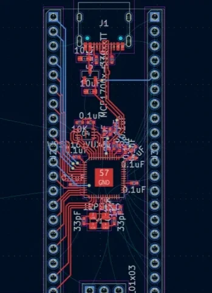
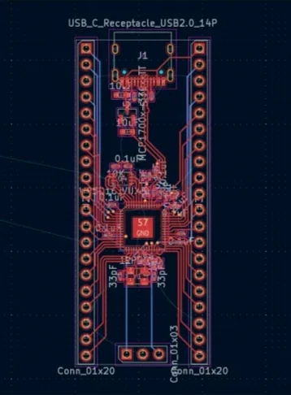
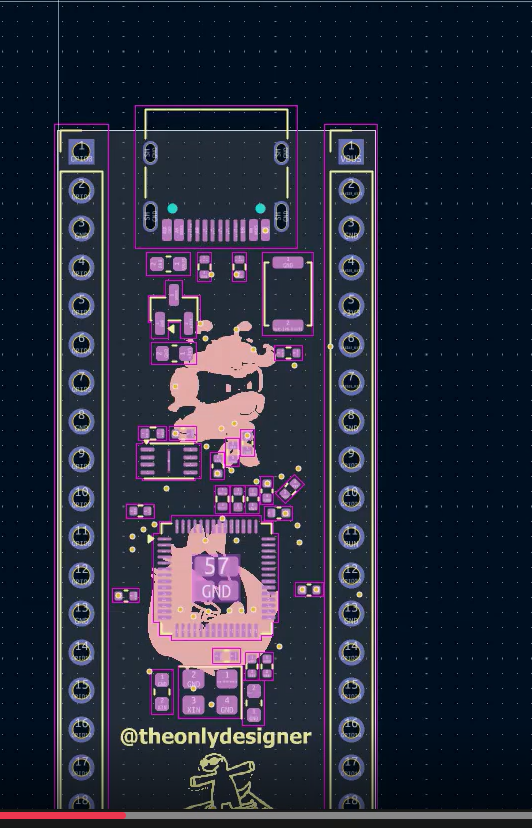
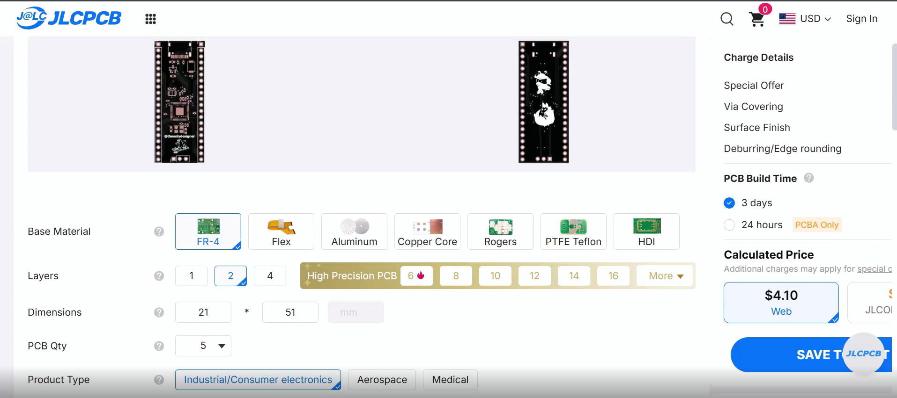

PS: Please ignore the dates as the timeline might be weird. This is because this project was initially meant for Half Life but I did not ship there. I have Timelapses for 85% of my work which i'll link instead of the images.

# October 1: Getting the KiCad ready
i kicked off the design process today by diving straight into the schematic editor on kicad to lay down the absolute foundation of the board. i placed the core rp2040 chip along with essential support components like the ldo voltage regulator and the w25q128 flash memory. mapping out the power pins and assign gpio lines to their corresponding nets took a while because i wanted to make sure i did not mix up any crucial connections [my schematic looked like a chaotic spiderweb by the end of it, but every pin had its rightful place].

[Timelapse](https://lapse.hackclub.com/timelapse/koFGrANDHxOM)

**Total time spent: 0.8hrs**

# October 1(Part 2): Working on the Schematic
this session was all about making sure the board can actually talk to external hardware and modules. i selected and placed the dual-row header connectors for all the breakout pins and spent a good chunk of time double-checking physical pitch dimensions. lining up the connectors cleanly while making sure the ground, power and gpio lines matched my planned hackpad matrix was tricky because the grid snap kept jumping around [getting header pins perfectly parallel is way more frustrating than it has any right to be].

[Timelapse](https://lapse.hackclub.com/timelapse/AStz1b4Fhh6p)

**Total time spent: 0.25hrs**

# October 2: Fixing labels
i opened up the project today only to realize i had made a complete mess of my net labels and misassigned a bunch of critical gpio pins. i spent the entire two hours carefully tracing each wire back to the rp2040 chip, deleting invalid connections and re-labeling every single net to avoid subtle bugs down the line. it was tedious work, but fixing these silly mistakes early in the schematic saved me from total disaster during routing [nothing brings you back to reality faster than auditing your own broken logic].

[Timelapse](https://lapse.hackclub.com/timelapse/vmYe6KXH--Wi)

**Total time spent: 0.23hrs**

# October 3: Finding the right parts and assigning footprints
today was dedicated to footprint assignment which is basically matching every virtual component to its real-world physical package. i spent time sifting through footprint libraries to find the precise 0402 models for all my passive resistors and capacitors as well as the exact qfn-56 footprint for the rp2040. double-checking land patterns and pad spacings was exhausting, but choosing the wrong package size would mean parts hovering off the board or shorting out [i never want to look at another 0402 capacitor datasheet ever again].

[Timelapse](https://lapse.hackclub.com/timelapse/lolXFzOe4yQK)

**Total time spent: 0.17hrs**

# October 4: Moving on to PCB
this ended up being one of my absolute longest design sessions because i finally moved from the schematic over to the pcb layout editor. i drew the edge cuts to define the physical border of the board and began the massive puzzle of placing components in logical groups. arranging dozens of tiny decoupling capacitors right next to the rp2040 power pins was super tough, so i scattered them around approximately while leaving room for future trace paths. i also swapped out a few bulky footprints for smaller variants to save precious board real estate [the workspace was pure chaos, but seeing the physical board shape felt awesome].

[Timelapse](https://lapse.hackclub.com/timelapse/BpPRrd9Gj9HX)

**Total time spent: 1.5hrs**

# October 5: Routing the left headers to chip
this was easily the most painful part of the entire week. of course, this is the exact 2-hour block where i forgot to start the lapse recording, so you'll just have to take my word for it that i was working and not staring blankly at a wall.

since this was my first time designing an RP2040 board from scratch, trying to connect the RP2040 pins to the left-side GPIO headers turned into a complete trace-routing nightmare. i was following the hack club stasis guide, but making clean connections for GPIO0 through GPIO15 without crossing traces or creating illegal angles felt like playing a high-stakes game of snake.

i had to pause every 5 minutes to watch multiple youtube tutorials on KiCad trace routing, net classes and how to use vias without making the PCB look like cheese. i kept triggering Design Rule Check (DRC) errors because my traces were either too close to the ground plane or running over decoupling capacitors. after two hours of tearing my hair out, re-routing lines three times over and wrestling with via placements, the left side is finally connected and fully routed.

**Total time spent: 2hrs**

# October 6: Right Side now
i tackled the right-side gpio header routing by systematically pulling copper traces from the rp2040 pins out toward the header pins and current-limiting resistors. since space was getting tight, i had to learn how to effectively use vias to jump traces between the top and bottom copper layers without ruining signal paths. i kept alternating between layers and checking clearances to make sure no two traces collided or ran parallel for too long [switching back and forth between front and back copper planes feels like a giant puzzle game once you get into the groove].

[Timelapse](https://lapse.hackclub.com/timelapse/k2gNUP4aI8xh)

**Total time spent: 0.55 hrs**

# October 7: Finishing up with Routes and pouring Ground Fill
after spending an hour routing the final batch of signals, i poured solid ground planes across both the top and bottom layers of the board. disaster struck almost immediately when i noticed that several traces had cut off sections of copper and created completely isolated ground islands. I had to rip up a dozen nicely routed traces and completely re-route them just to open up paths for ground continuity [ground fills look super satisfying until they destroy hours of your previous routing work].

[Timelapse](https://lapse.hackclub.com/timelapse/fekKvQMEnl0S)

**Total time spent: 0.55 hrs**

# October 8: Design Rules and fixing the errors
i hit the design rule checker button today and was greeted by an absolute wall of red error markers pointing out clearance violations and unconnected nets. i spent the entire session tweaking trace widths, pushing vias around, and finding far more efficient paths for tight copper traces. resolving every single drc flag felt like playing high-stakes whack-a-mole, but clearing the last error was ridiculously satisfying [the drc tool is a harsh critic, but it definitely saved me from ordering a completely useless brick].

[Timelapse](https://lapse.hackclub.com/timelapse/nZIj2UNPu_0h)

**Total time spent: 0.65 hrs**

# October 9: Fixing a major error and silkscreen
while inspecting my layout i made the horrifying discovery that i had swapped two resistor values near the crystal oscillator circuit. i moved them back into their correct positions and re-routed the surrounding connections from scratch. to fix the remaining isolated ground planes, i used some ai prompts to figure out optimal via stitching locations and tied all the ground zones together cleanly. I wrapped up by customizing the silkscreen with my username and cool hack club logo artwork [if the circuit somehow fails, at least the board will look amazingly stylish].

[Timelapse](https://lapse.hackclub.com/timelapse/HYEuobokz6vN)

**Total time spent: 0.82 hrs**

# October 9: More silkscreen
i spent the first half of this session fine-tuning the silkscreen layer so the custom graphics would actually render crisply in physical two-tone white ink. a few hack club stickers looked super muddy in black and white, so i tested different vector art assets until i found clean ones that fit nicely on the back of the board. once everything looked polished, i generated the gerber and drill files, compressed them, and headed over to jlcpcb to check out assembly prices [seeing the high total cost in the cart was a swift reality check].

[Timelapse](https://lapse.hackclub.com/timelapse/TIuRY7vu_TxT)

**Total time spent: 0.43 hrs**

# October 10: Figuring out BOM
i uploaded my component placement file and bill of materials to jlcpcb, only to run into major component rotation and alignment bugs in their web viewer. i went through and manually adjusted offset coordinates, fixed broken manufacturer part numbers, and aligned every single part correctly over its pads in 3d. unfortunately, the final pcba quote far exceeded my allocated grant budget, which means i will be ordering bare boards and hand-soldering every microscopic component myself [my hands are already shaking thinking about hand-soldering that qfn rp2040 chip during build week].

[Timelapse](https://lapse.hackclub.com/timelapse/_C8K82IgWKmQ)

**Total time spent: 0.53 hrs**

# October 11: Readme and Repo
So I finished it all off by creating the BOM and finding these freaking components which were genuinely so hard to find that I felt like a cyber crime investigator. Also I planned making a hackpad with this devboard but I soon realised I won't get enough grant to make it so I dropped the idea unfortunately after finding all the resources for it. I then wrote the readme files and organised the project structure.
Overall I'm pretty happy with how this project turned out. Now let's see what we face in building.

**Total time spent: 1.7hrs**
