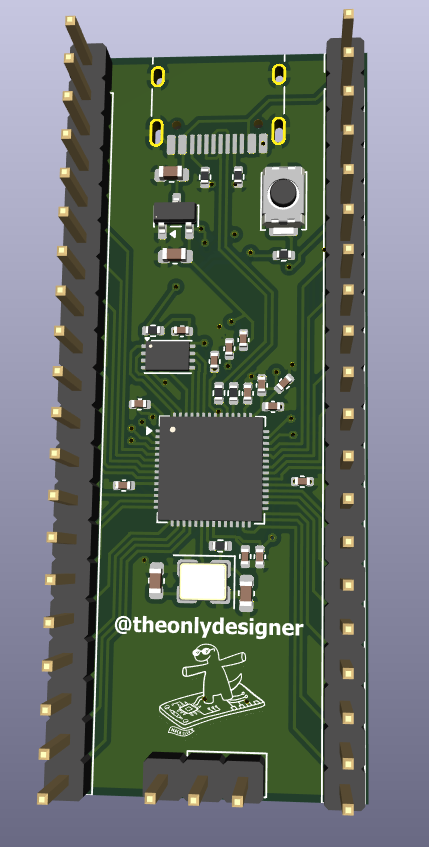
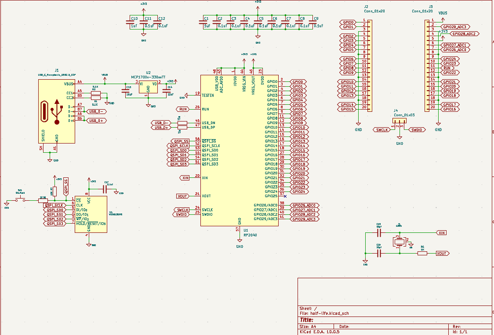
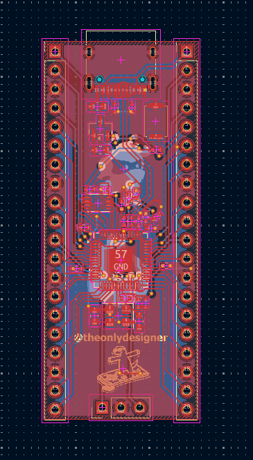

# week 1: rp2040 dev board & mini hackpad

## project goals
* **Target Specs:** custom RP2040 microcontroller board using the QFN-56 package, 16MB QSPI flash, 12MHz crystal oscillator, USB-C connector with 5.1k CC pull-down resistors, and dual-row breakout headers for all GPIO pins to drive a mini hackpad.
* **Design Philosophy:** build a functional dev board from absolute ground zero using the hack club stasis guide so i finally understand what goes on under the hood of a raspberry pi pico [instead of treating microcontrollers like magic black boxes].
* **Why I'm building this:** week 1 theme is PCB, and i needed a custom board to integrate with an old mini hackpad design i had lying around. also i wanted to suffer through routing 0402 passives and tiny IC pins.

## deep brief
this project is essentially a custom raspberry pi pico clone built from scratch using the hack club stasis devboard guide. instead of buying a ready-made dev board you have to manually route every single trace and place every tiny passive component [because suffering builds character]. 

at the center of the madness is the RP2040 microcontroller chip which handles all the processing. it is paired with a W25Q128 QSPI flash memory chip for storing firmware and a 12MHz crystal oscillator to provide the clock signal. power is delivered via a USB-C connector featuring 5.1k pull-down resistors so modern power supplies actually negotiate power correctly. an MCP1700 LDO voltage regulator takes that input and steps it down to a stable 3.3V for the system. finally every single GPIO pin is broken out onto dual headers so the board can easily interface with a mini hackpad.

## bill of materials (BOM)

| Part | Quantity | No of items in 1 unit | Price w/o shipping | Price |
| :--- | :---: | :---: | :---: | :---: |
| 1uF Capacitor | 1 | 2 | 0.1 | 0.1 |
| 0.1uF Capacitor | 1 | 11 | 0.1 | 0.1 |
| 10uF Capacitor | 1 | 2 | 0.1 | 0.1 |
| 33pF Capacitor | 1 | 2 | 0.2 | 0.2 |
| USB_C_Receptacle_USB2.0_14P | 1 | 1 | 0.3 | 0.3 |
| Conn_01x20 | 1 | 2 | 0.6 | 0.6 |
| Conn_01x03 | 1 | 1 | 0.16 | 0.16 |
| 5.1K Resistor | 1 | 2 | 0.1 | 0.1 |
| 27 Resistor | 1 | 2 | 0.1 | 0.1 |
| 1K Resistor | 1 | 2 | 0.1 | 0.1 |
| 10K Resistor | 1 | 1 | 0.1 | 0.1 |
| SW_Push | 1 | 1 | 0.11 | 0.11 |
| RP2040 Chip | 1 | 1 | 0.84 | 1.3 |
| MCP1700x-330xxTT | 1 | 1 | 0.5 | 0.5 |
| W25Q128JVS | 1 | 1 | 5.02 | 5.02 |
| 12MHz Crystal | 1 | 1 | 0.39 | 0.39 |
| PCB w/ Stencil | 1 | 1 | 6 | 10 |
| Solder Paste | 1 | 1 | 2.3 | 3 |
| Tweezers | 1 | 1 | 1.8 | 1.8 |
| Solder Iron and stuff related to that | 1 | 1 | 3.2 | 3.2 |

## visual showcase

*(a gorgeous 3D render of a board that will probably release the magic smoke the second power is applied)*

*(the schematic page where i stared into the void until the net names started making sense)*

*(the actual PCB layout before sending it off to the fab house to be judged)*